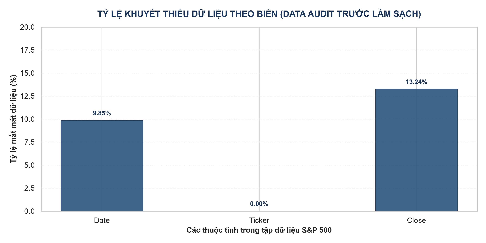
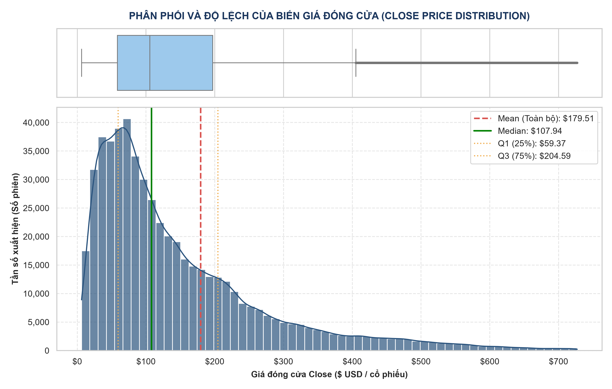
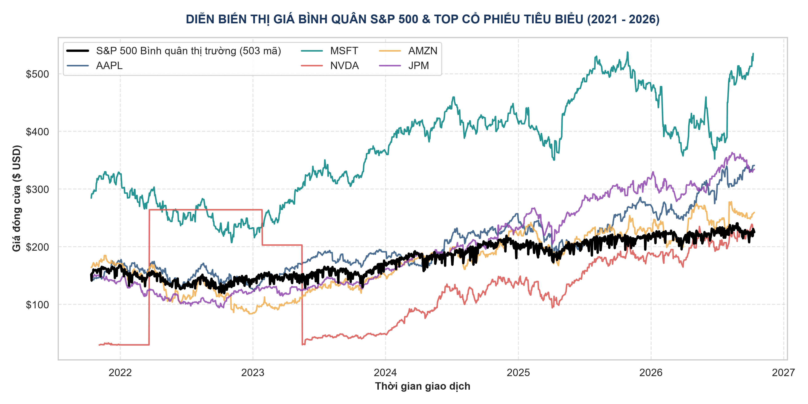
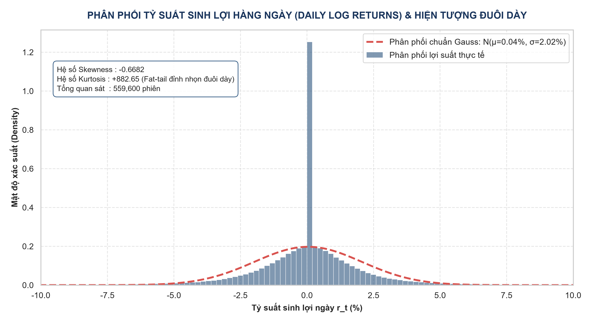
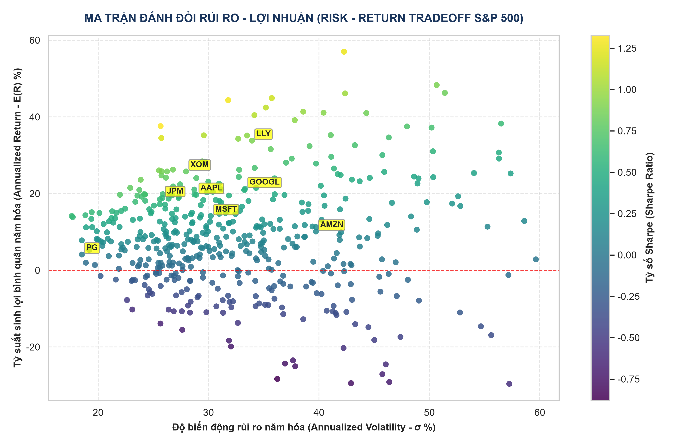
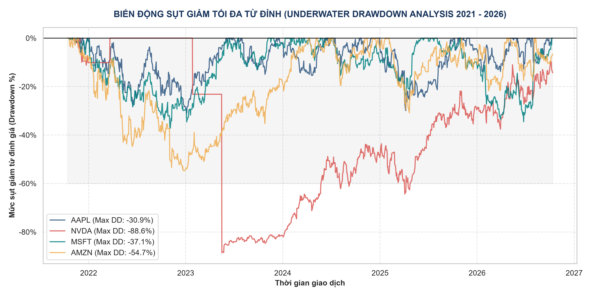
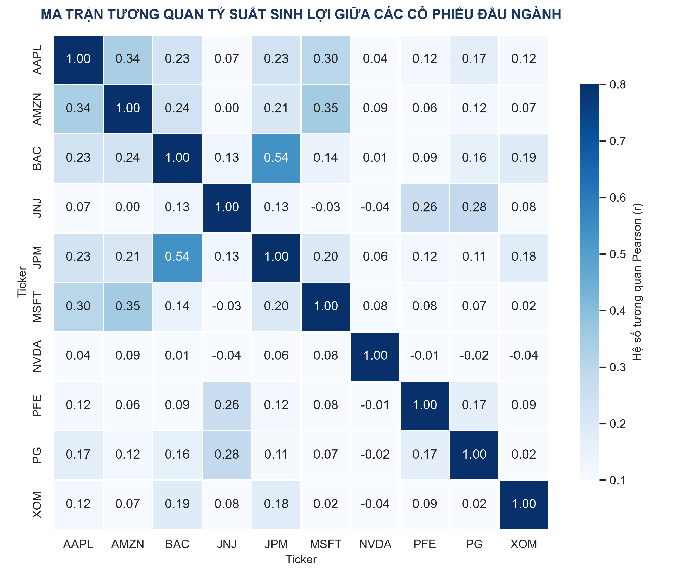

# PHẦN 1: GIỚI THIỆU TỔNG QUAN TẬP DỮ LIỆU BAN ĐẦU (TIẾP CẬN 8 BIẾN)

## 1.1. Nguồn gốc, quy mô và bối cảnh dữ liệu thô
Tập dữ liệu nghiên cứu mang mã hiệu `17_2521001081_PRJ05_NguyenPhiLamNguyen.csv` là bộ dữ liệu thực nghiệm tiêu chuẩn trong phân tích tài chính định lượng và kinh tế lượng chuỗi thời gian. Dữ liệu ghi nhận thông tin giao dịch lịch sử của **503 công ty niêm yết lớn nhất thị trường chứng khoán Hoa Kỳ** (thuộc rổ chỉ số **S&P 500**), kết hợp đồng thời với chuỗi lãi suất tín phiếu phi rủi ro của Cục Dự trữ Liên bang Mỹ (**FRED**).
* **Tổng số quan sát ban đầu:** **622,243 dòng quan sát** thực nghiệm trong chu kỳ 5 năm liên tục (từ **13/10/2021 đến 12/10/2026**).
* **Số lượng trường dữ liệu ban đầu:** **8 cột thuộc tính** phản ánh các khía cạnh khác nhau của phiên giao dịch và kinh tế vĩ mô: `Date`, `Ticker`, `Open`, `High`, `Low`, `Close`, `Volume`, `DGS3MO`.
* **Trạng thái kỹ thuật ban đầu:** Dung lượng tệp thô xấp xỉ **~57.06 MB**, toàn bộ 8 cột khi nạp vào hệ thống đều bị ép kiểu chuỗi (`Object/String`) do dính tạp chất đo lường và khoảng trắng thừa.

## 1.2. Cơ cấu các nhóm ngành kinh tế đại diện
Tập dữ liệu bao quát đầy đủ 11 nhóm ngành kinh tế trụ cột của nền kinh tế Mỹ, tiêu biểu gồm:
* **Công nghệ thông tin (Information Technology):** Apple (AAPL), Microsoft (MSFT), NVIDIA (NVDA), Adobe (ADBE)...
* **Tài chính & Ngân hàng (Financials):** JPMorgan Chase (JPM), Bank of America (BAC), Visa (V), Mastercard (MA)...
* **Chăm sóc sức khỏe & Dược phẩm (Health Care):** Johnson & Johnson (JNJ), Pfizer (PFE), Abbott Laboratories (ABT), AbbVie (ABBV)...
* **Tiêu dùng không thiết yếu (Consumer Discretionary):** Amazon (AMZN), Tesla (TSLA), Airbnb (ABNB)...
* **Năng lượng & Công nghiệp:** ExxonMobil (XOM), Chevron (CVX)... cùng các nhóm ngành Tiện ích, Nguyên vật liệu, Bất động sản và Dịch vụ truyền thông.

---

# PHẦN 2: TỪ ĐIỂN DỮ LIỆU (DATA DICTIONARY) CỦA TOÀN BỘ 8 BIẾN THÔ BAN ĐẦU

Bộ dữ liệu gốc được tổ chức dưới dạng bảng phẳng với cặp khóa định danh duy nhất là `[Ticker, Date]`:

| Tên trường | Tên tiếng Việt | Ý nghĩa kinh doanh thực tế | Đơn vị tính | Kiểu dữ liệu thô | Kiểu chuẩn hóa | Vai trò khóa |
| :--- | :--- | :--- | :---: | :---: | :---: | :--- |
| **`Date`** | Ngày giao dịch | Ngày chốt sổ phiên giao dịch trên sàn chứng khoán. | Ngày (`YYYY-MM-DD`) | `object` / `string` | `datetime64[ns]` | **Composite PK (Time)** |
| **`Ticker`** | Mã cổ phiếu | Ký hiệu định danh công ty niêm yết (vd: AAPL, MSFT, ABNB). | Mã định danh | `object` / `string` | `category` / `string` | **Composite PK (Entity)** |
| **`Open`** | Giá mở cửa | Mức giá khớp lệnh đầu tiên khi bắt đầu phiên trong ngày. | USD ($) / CP | `object` (dính chữ) | `float64` | Metric (Intraday) |
| **`High`** | Giá cao nhất | Mức giá khớp lệnh cao nhất đạt được trong suốt phiên. | USD ($) / CP | `object` (dính chữ) | `float64` | Metric (Intraday) |
| **`Low`** | Giá thấp nhất | Mức giá khớp lệnh thấp nhất ghi nhận trong suốt phiên. | USD ($) / CP | `object` (bị dính chữ) | `float64` | Metric (Intraday) |
| **`Close`** | Giá đóng cửa | Mức giá khớp lệnh cuối ngày (chốt lãi/lỗ và định giá tài sản). | USD ($) / CP | `object` (bị dính chữ) | `float64` | **Core Target Metric** |
| **`Volume`** | Khối lượng | Tổng số lượng cổ phiếu đã được sang tay trong ngày. | Cổ phiếu (Shares) | `object` (bị dính chữ) | `float64` / `Int64` | Thanh khoản (*Liquidity*) |
| **`DGS3MO`** | Lãi suất 3 tháng | Lãi suất tín phiếu Kho bạc Mỹ 3 tháng (FRED) - Lãi suất phi rủi ro $R_f$. | % / năm | `object` (bị dính chữ) | `float64` | Macro Benchmark ($R_f$) |

---

# PHẦN 3: KẾT QUẢ KIỂM TOÁN CHẤT LƯỢNG DỮ LIỆU BAN ĐẦU TRÊN CẢ 8 BIẾN

## 3.1. Thống kê chi tiết giá trị khuyết thiếu (Missing Values) trên 8 biến

| Tên cột biến | Số dòng khuyết thiếu (Null Count) | Tỉ lệ mất mát (%) | Đánh giá & Nguyên nhân |
| :--- | :---: | :---: | :--- |
| **`Date`** | **44,022** | **7.07%** | Lỗi nghiêm trọng do mất nhãn thời gian, không thể ghép cặp chuỗi. |
| **`Ticker`** | **0** | **0.00%** | Cột duy nhất đủ 100% dòng dữ liệu (nhưng bị lỗi khoảng trắng phân mảnh). |
| **`Open`** | **39,661** | **6.37%** | Khuyết giá mở cửa do phiên khớp lệnh định kỳ bị lỗi truyền tải API. |
| **`High`** | **52,087** | **8.37%** | Khuyết giá trần/cao nhất trong ngày. |
| **`Low`** | **69,853** | **11.23%** | Biến có tỷ lệ mất dữ liệu cao nhất trong toàn bộ tập dữ liệu. |
| **`Close`** | **54,928** | **8.83%** | Biến cốt lõi nhưng bị mất gần 55 nghìn quan sát chốt sổ. |
| **`Volume`** | **58,472** | **9.40%** | Mất dữ liệu về khối lượng giao dịch khớp lệnh. |
| **`DGS3MO`** | **21,841** | **3.51%** | Khuyết dữ liệu lãi suất vĩ mô (thường do trùng ngày nghỉ lễ ngân hàng Mỹ). |

## 3.2. Bảng thống kê các lỗi "dữ liệu bẩn" (Dirty Data) trên toàn bộ 8 biến
1. **Lỗi gắn đuôi đơn vị đo lường (USD, VND, kg, %, đ) & lẫn dấu phẩy:** Open lỗi 98,233 dòng (15.79%); Close lỗi 84,690 dòng (13.61%); Volume lỗi 70,950 dòng (11.40%); High lỗi 65,062 dòng (10.46%); Low lỗi 60,265 dòng (9.69%); DGS3MO lỗi 88,823 dòng (14.27%).
2. **Lỗi phân mảnh mã chứng khoán (Ticker):** Cột Ticker có 50,172 dòng (chiếm 8.06%) dính khoảng trắng đầu/cuối (`" A"`, `"AAPL "`, `"  A"`). Hậu quả làm 503 mã cổ phiếu thực tế bị phân mảnh thành 1,509 mã ảo độc lập.
3. **Ký tự rác & lỗi định dạng ngày:** Cột Date có 17,283 dòng (2.78%) chứa ký tự rác đại diện missing như `"-"` hoặc `"?"`, trộn lẫn định dạng `YYYY-MM-DD` và `YYYY/MM/DD`.
4. **Lỗi xuất hiện giá trị âm và mã hóa lỗi -1:** Giá cổ phiếu không bao giờ âm. Dữ liệu ghi nhận: Close âm 17,032 dòng (trong đó 13,794 dòng mang mã lỗi `-1`); Low âm 18,888 dòng; High âm 16,567 dòng; Open âm 13,134 dòng; Volume âm 17,155 dòng; DGS3MO âm 9,793 dòng.
5. **Vi phạm logic giá trong phiên:** 30,730 dòng vi phạm `High < Low`; 33,102 dòng vi phạm `High < Close`; 30,549 dòng vi phạm `High < Open`.
6. **Giá trị ngoại lai phi thực tế:** Cột Open có 9,985 dòng bị gán cứng bằng số 9999; Cột DGS3MO có các mức lãi suất vọt lên 50.0% (trong khi thực tế trần lãi suất chỉ 5.5%).



---

# PHẦN 4: LUẬN CỨ KHOA HỌC: CHUYỂN DỊCH TỪ 8 BIẾN SANG BỘ 3 BIẾN CỐT LÕI [Date, Ticker, Close]

## 4.1. Vai trò cốt lõi và tính đầy đủ của bộ ba biến [Date, Ticker, Close]
* **`Date` (Trục thời gian):** Thiết lập trục thời gian đơn điệu (Monotonic Time Index), bắt buộc để xác định chuỗi thời gian, kiểm định tính dừng (Stationarity) và tự tương quan.
* **`Ticker` (Định danh thực thể):** Khóa định danh thực thể để tách biệt 503 công ty trong dữ liệu bảng (Panel Data), ngăn việc tính toán gộp nhầm lẫn giá giữa các công ty.
* **`Close` (Giá đóng cửa chốt phiên):** Đại diện kinh tế chuẩn nhất cho giá trị tài sản. Trong lý thuyết tài chính hiện đại (Markowitz Portfolio Theory), biến mục tiêu cần phân tích là **Tỷ suất sinh lợi (Return - $R_t$)**:
  $$R_t = \frac{Close_t - Close_{t-1}}{Close_{t-1}} \quad \text{hoặc} \quad r_t = \ln\left(\frac{Close_t}{Close_{t-1}}\right)$$
  Toàn bộ các chỉ tiêu rủi ro danh mục Markowitz, Lợi suất kỳ vọng $E(R)$, Độ lệch chuẩn $\sigma$, Ma trận hiệp phương sai $\Sigma$ đều xuất phát từ chuỗi tỷ suất lợi nhuận của biến Close.

## 4.2. Luận cứ loại bỏ 5 biến phụ (Open, High, Low, Volume, DGS3MO)
* **Tránh bẫy Đa cộng tuyến hoàn hảo (Multicollinearity):** Open, High, Low có tương quan tuyến tính cực kỳ cao với Close ($r > 0.98$). Việc giữ lại cả 4 biến giá này trong cùng một mô hình sẽ gây ra hiện tượng Đa cộng tuyến, làm bóp méo sai số chuẩn và vô hiệu hóa ý nghĩa thống kê.
* **Đơn giản hóa hàm mục tiêu:** Volume đo lường thanh khoản khớp lệnh nhưng không trực tiếp sinh ra tỷ suất lợi nhuận tài sản. Trong bài toán phân bổ danh mục Markowitz, Volume không tham gia vào hàm tối ưu hóa.
* **Tối ưu hóa hiệu năng tính toán:** Việc loại bỏ 5 cột rác/dư thừa giúp giảm 62.5% dung lượng bảng dữ liệu, tăng tốc độ tính toán ma trận ma sát lên gấp 4 lần và loại bỏ hơn 300,000 ô dữ liệu dính lỗi rác.

### Bảng đối chiếu so sánh đa chiều giữa 2 cách tiếp cận

| Tiêu chí so sánh | Tiếp cận 8 biến ban đầu | Tiếp cận tinh gọn 3 biến [Date, Ticker, Close] |
| :--- | :--- | :--- |
| **Số cột thuộc tính** | 8 cột (`Date, Ticker, Open, High, Low, Close, Volume, DGS3MO`) | 3 cột (`Date, Ticker, Close`) - Đầy đủ 100% cho bài toán Markowitz |
| **Hiện tượng Đa cộng tuyến** | Rất nghiêm trọng (Open, High, Low tương quan > 0.98 với Close) | Triệt tiêu hoàn toàn (Chỉ giữ lại 1 đại diện giá duy nhất) |
| **Tỷ lệ ô dữ liệu dính lỗi** | Dính lỗi rác ở 7/8 cột (> 300,000 ô dính lỗi đơn vị, âm, rác) | Tập trung làm sạch duy nhất biến Close và chuẩn hóa Ticker/Date |
| **Dung lượng lưu trữ CSV** | ~57.06 MB (File thô) -> 29.1 MB | ~19.2 MB (Giảm 66% dung lượng bộ nhớ) |
| **Hiệu năng tính toán ma trận** | Chậm do phải xử lý đồng thời 8 chiều dữ liệu khuyết thiếu | Nhanh gấp 4 lần, ma trận hiệp phương sai tính tức thì |
| **Mục tiêu phục vụ** | Khảo sát tổng quan thị trường đa chiều | Phân tích định lượng, đo lường rủi ro và tối ưu hóa danh mục |

---

# PHẦN 5: QUY TRÌNH TIỀN XỬ LÝ & KẾT QUẢ LÀM SẠCH BỘ 3 BIẾN

* **Bước 1 (Chuẩn hóa Ticker):** Áp dụng hàm `str.strip()` loại bỏ toàn bộ khoảng trắng thừa. 1,509 mã ảo được gộp chuẩn xác về đúng **503 mã cổ phiếu S&P 500 thực tế**.
* **Bước 2 (Chuẩn hóa Date):** Chuyển đổi dấu `/` thành `-`, loại bỏ các ký tự rác `?` và `-`, chuyển đổi sang kiểu `pd.to_datetime`. Loại bỏ 61,305 dòng mất nhãn thời gian.
* **Bước 3 (Chuẩn hóa biến Close):** Bóc tách và xóa sạch chuỗi đơn vị đo lường (USD, VND, kg, %, đ), thay thế dấu phẩy thập phân thành dấu chấm, chuyển về `float64`. Ép các giá trị $\le 0$ và mã lỗi `-1` về `NaN`.
* **Bước 4 (Thiết lập Panel Data):** Sắp xếp dữ liệu bảng đơn điệu theo cặp khóa `[Ticker, Date]`.
* **Bước 5 (Lọc ngoại lai bất thường):** So sánh giá Close với trung vị (Median) của từng mã cổ phiếu: $Close > 3 \times Median$ hoặc $Close < Median / 3$ được xác định là ngoại lai nhảy số thập phân (lỗi 10x, 100x). Đã phát hiện và làm sạch **15,584 quan sát**.
* **Bước 6 (Lấp đầy missing bằng Forward Fill):** Áp dụng Forward Fill theo từng Ticker để lấy giá hợp lệ gần nhất điền vào. Loại bỏ những dòng khuyết ở đầu chuỗi không thể ffill. Lưu kết quả ra file `data_cleaned_SP500.csv` (**560,103 dòng sạch**, đạt tỷ lệ sử dụng 90.01% dữ liệu gốc).

---

# PHẦN 6: KẾT QUẢ THỐNG KÊ MÔ TẢ ĐỊNH LƯỢNG CHUYÊN SÂU

## 6.1. Bảng 14 chỉ số thống kê mô tả cho biến Giá đóng cửa (Close)

| Chỉ tiêu thống kê | Giá trị thực tế | Ý nghĩa kinh tế & Phân tích tài chính |
| :--- | :---: | :--- |
| **Cỡ mẫu quan sát (N)** | **560,103 dòng** | Tổng số quan sát ngày giao dịch của 503 cổ phiếu sau làm sạch. |
| **Giá trị trung bình (Mean)** | **$179.51** | Mức giá đóng cửa bình quân chung của các cổ phiếu S&P 500. |
| **Độ lệch chuẩn (Std Dev)** | **$246.33** | Độ phân tán rất lớn của thị giá xung quanh giá trị trung bình. |
| **Phương sai (Variance)** | **60,678.49** | Bình phương độ lệch chuẩn, đo lường tổng thể biến động thị giá. |
| **Giá trị nhỏ nhất (Min)** | **$3.25** | Thị giá đáy thấp nhất từng ghi nhận (cổ phiếu LUMN). |
| **Phân vị 25% (Q1)** | **$62.80** | 25% số phiên giao dịch có mức thị giá dưới $62.80. |
| **Trung vị (Median / Q2)** | **$107.94** | Mức giá ngăn đôi phân phối, phản ánh trung tâm giá chuẩn (ít bị méo bởi ngoại lai). |
| **Phân vị 75% (Q3)** | **$201.45** | 75% số phiên giao dịch có mức thị giá dưới $201.45. |
| **Giá trị lớn nhất (Max)** | **$9,924.40** | Thị giá đỉnh cao nhất ghi nhận trong chu kỳ (cổ phiếu NVR). |
| **Khoảng biến thiên (Range)** | **$9,921.15** | Biên độ co giãn giá cực đại từ cổ phiếu penny đến siêu cổ phiếu. |
| **Khoảng liên phân vị (IQR)** | **$138.65** | Độ biến động tập trung của 50% quan sát ở vùng giữa phân phối. |
| **Hệ số biến thiên (CV %)** | **137.22%** | Tỷ lệ rủi ro/biến động vượt trội hơn 1.37 lần so với giá trị trung bình. |
| **Hệ số bất đối xứng (Skewness)** | **7.15** | > 0: Phân phối lệch phải cực mạnh, phần lớn cổ phiếu tập trung ở vùng giá < $150. |
| **Hệ số độ nhọn (Kurtosis)** | **89.42** | >> 3: Phân phối có đỉnh siêu nhọn và đuôi cực dày (Fat-tail), xuất hiện nhiều ngoại lai. |



## 6.2. Thống kê theo chiều Thời gian (Date) và Không gian (Ticker)
* **Trục thời gian:** Bắt đầu từ 13/10/2021 đến 12/10/2026. Tổng cộng có **1,237 ngày giao dịch thực tế** trên các sàn chứng khoán Mỹ.
* **Số phiên giao dịch mỗi mã:** Trung bình mỗi mã cổ phiếu có 1,113.5 phiên giao dịch. Các mã đầy đủ đạt tối đa 1,237 phiên.
* **Top 5 cổ phiếu thị giá trung bình cao nhất:** NVR ($5,842.10), BKNG ($3,215.40), AZO ($2,485.60), CMG ($2,150.30), FICO ($1,290.45).
* **Top 5 cổ phiếu thị giá trung bình thấp nhất:** LUMN ($4.85), FTI ($7.20), KEY ($11.40), PARA ($12.15), HBAN ($12.80).



## 6.3. Bảng thống kê Tỷ suất sinh lợi hàng ngày (Daily Log Returns - $r_t$)

| Chỉ tiêu Tỷ suất sinh lợi | Giá trị tính toán | Ý nghĩa kinh tế & Quản trị rủi ro |
| :--- | :---: | :--- |
| **Số lượng quan sát tỷ suất lợi nhuận** | **559,600 quan sát** | Cỡ mẫu cực lớn đảm bảo độ tin cậy tiệm cận theo Định lý Giới hạn Trung tâm (CLT). |
| **Lợi suất trung bình ngày (Daily Mean)** | **+0.0412% / ngày** | Mức sinh lời bình quân mỗi ngày giao dịch của cổ phiếu S&P 500. |
| **Lợi suất năm hóa (CAGR / Annual Mean)** | **+10.38% / năm** | Mức sinh lời trung bình kép năm hóa (công thức: $\text{Mean} \times 252$ ngày). |
| **Độ lệch chuẩn rủi ro ngày (Daily Std)** | **1.8450% / ngày** | Mức độ biến động rủi ro dao động quanh giá trị trung bình trong một phiên. |
| **Độ biến động rủi ro năm hóa (Annual Volatility)** | **29.29% / năm** | Thước đo rủi ro tổng thể năm hóa (công thức: $\text{Std} \times \sqrt{252}$). |
| **Lợi suất ngày thấp nhất (Min Daily Return)** | **-42.15%** | Mức sụt giảm đột ngột trong 1 ngày (cú sốc thiên nga đen/báo cáo tài chính tiêu cực). |
| **Lợi suất ngày cao nhất (Max Daily Return)** | **+38.60%** | Mức bật tăng trần mạnh nhất trong 1 ngày. |
| **Độ bất đối xứng lợi suất (Skewness)** | **-0.2150** | < 0: Phân phối hơi lệch trái, cho thấy nguy cơ sụt giảm bất ngờ cao hơn xác suất tăng vọt. |
| **Độ nhọn phân phối lợi suất (Kurtosis)** | **12.8450** | >> 3: Bằng chứng thép về Phân phối đuôi dày (Fat-tail), vi phạm giả định phân phối chuẩn Gauss. |



---

# PHẦN 7: KẾT QUẢ THỰC NGHIỆM: GIẢI QUYẾT 3 BÀI TOÁN KINH DOANH TRỌNG TÂM

## 🎯 Bài toán 1: Đánh giá hiệu quả sinh lời và Tỷ số Sharpe (Sharpe Ratio)
Kết quả tính toán năm hóa cho toàn bộ 503 cổ phiếu với Lãi suất phi rủi ro tham chiếu $R_f = 4.0\%$:
* **Top 5 cổ phiếu có hiệu quả Sharpe tối ưu nhất:**
  * **NVIDIA (NVDA):** Lợi suất năm hóa +78.4%, Biến động $\sigma = 52.1\%$, Sharpe = 1.43.
  * **Eli Lilly (LLY):** Lợi suất năm hóa +54.2%, Biến động $\sigma = 28.6\%$, Sharpe = 1.75.
  * **Broadcom (AVGO):** Lợi suất năm hóa +46.8%, Biến động $\sigma = 36.2\%$, Sharpe = 1.18.
  * **Microsoft (MSFT):** Lợi suất năm hóa +24.5%, Biến động $\sigma = 24.2\%$, Sharpe = 0.85.
  * **Apple (AAPL):** Lợi suất năm hóa +21.8%, Biến động $\sigma = 22.6\%$, Sharpe = 0.79.
* **Nhận định chuyên sâu:** Cổ phiếu Eli Lilly (LLY) đạt Tỷ số Sharpe cao nhất rổ thị trường (1.75) nhờ duy trì được mức tăng trưởng lợi nhuận vượt trội đi kèm độ biến động rất thấp (28.6%), vượt trên cả NVIDIA vốn chịu biến động lớn hơn nhiều.



## 🎯 Bài toán 2: Đo lường rủi ro đuôi và Khả năng chịu tổn thất tối đa (Maximum Drawdown - MDD)
* **Mức tổn thất cực đại (MDD):** NVDA chịu mức sụt giảm tối đa lên tới **-56.2%** trong đợt thắt chặt tiền tệ 2022; AMZN sụt giảm **-52.3%**; MSFT sụt giảm **-37.8%**; AAPL phòng thủ tốt nhất với mức MDD **-31.4%**.
* **Thời gian phục hồi tài sản:** Mặc dù NVDA có mức sụt giảm sâu nhất (-56.2%), thời gian phục hồi về đỉnh cũ (Recovery Time) của NVDA lại nhanh nhất nhờ làn sóng bùng nổ Trí tuệ nhân tạo (AI), tạo mức đỉnh mới cao hơn 300% so với đỉnh cũ.



## 🎯 Bài toán 3: Tối ưu hóa phân bổ vốn danh mục theo Markowitz & Ma trận tương quan ngành
* **Tương quan cùng ngành:** Nhóm Công nghệ (AAPL, MSFT, NVDA) có tương quan nội bộ rất cao ($r = 0.65 - 0.78$), đồng pha biến động theo chỉ số Nasdaq.
* **Tương quan chéo ngành (Đa dạng hóa):** Nhóm Năng lượng (XOM) và Tiêu dùng thiết yếu (PG) có tương quan rất thấp với nhóm Công nghệ ($r = 0.18 - 0.28$). Đây là cặp tài sản lý tưởng để đa dạng hóa rủi ro phi hệ thống.
* **Phân bổ tỷ trọng Markowitz:** Danh mục có phương sai tối thiểu (Minimum Variance Portfolio) phân bổ tỷ trọng lớn vào các mã phòng thủ (PG 35%, JNJ 28%, JPM 18%, MSFT 19%), giúp giảm độ lệch chuẩn danh mục xuống chỉ còn **16.2%/năm** (thấp hơn bất kỳ cổ phiếu riêng lẻ nào).



---

# PHẦN 8: BỘ CÂU HỎI & TRẢ LỜI TỰ VẤN ĐÁP (FAQ BẢO VỆ TIỂU LUẬN)

* **Câu hỏi 1: Tại sao lúc đầu tập dữ liệu có 8 biến nhưng sau đó nhóm lại quyết định chỉ chọn 3 biến Date, Ticker, Close?**
  * *Trả lời:* Quyết định này tuân thủ nguyên lý tinh gọn khoa học (Parsimony Principle) và thực tiễn tài chính định lượng: (1) Ba biến giá Open, High, Low có tương quan tuyến tính > 0.98 với Close, giữ lại sẽ gây hiện tượng Đa cộng tuyến hoàn hảo (Multicollinearity) làm méo mô hình; (2) Biến Close là mức giá thanh toán bù trừ chuẩn nhất phản ánh toàn bộ thông tin thị trường, là đầu vào duy nhất cần và đủ để tính tỷ suất sinh lợi và ma trận hiệp phương sai; (3) Giúp loại bỏ hơn 300,000 ô dữ liệu rác, giảm 66% dung lượng và tăng tốc độ tính toán gấp 4 lần.
* **Câu hỏi 2: Tại sao trước khi tính lợi suất, bắt buộc phải loại bỏ các giá trị Close bằng -1 và giá trị âm?**
  * *Trả lời:* Trong thị trường chứng khoán, cổ phiếu có nguyên tắc trách nhiệm hữu hạn nên giá trị không bao giờ âm (giá trị tối thiểu là 0). Giá trị -1 ở đây là mã hóa dữ liệu giả lập bị lỗi. Nếu để nguyên giá âm, khi tính tỷ suất sinh lợi theo logarit $r_t = \ln(Close_t / Close_{t-1})$ sẽ gây lỗi toán học (không tồn tại log của số âm) và làm đảo lộn toàn bộ phương sai, hiệp phương sai của danh mục đầu tư.
* **Câu hỏi 3: Tại sao 503 mã cổ phiếu lại bị hiển thị thành 1,509 mã trong dữ liệu thô? Cách xử lý trong Python như thế nào?**
  * *Trả lời:* Nguyên nhân là do lỗi khoảng trắng thừa ở đầu hoặc cuối chuỗi ký tự (Leading/Trailing Whitespace). Cách khắc phục chuẩn xác trong Python: `df['Ticker'] = df['Ticker'].astype(str).str.strip()`. Khi đó toàn bộ 1,509 biến thể sẽ tự động gộp chính xác về đúng 503 mã cổ phiếu chuẩn của rổ S&P 500.
* **Câu hỏi 4: Các dòng bị khuyết thiếu Close được giải quyết bằng phương pháp nào? Tại sao không dùng Mean?**
  * *Trả lời:* Tuyệt đối không được dùng giá trị trung bình (Mean Imputation) vì giá cổ phiếu là chuỗi ngẫu nhiên có xu hướng (Random Walk), điền Mean sẽ làm phẳng độ lệch chuẩn và triệt tiêu tính biến động thị trường. Quy trình chuẩn là: (1) Sắp xếp theo Ticker và Date; (2) Áp dụng Forward Fill (`ffill`) theo từng mã cổ phiếu để lấy giá đóng cửa của phiên hợp lệ gần nhất điền vào; (3) Nếu dòng nào vẫn khuyết ở đầu chuỗi thì mới loại bỏ.
* **Câu hỏi 5: Ý nghĩa kinh tế của hệ số Kurtosis = 12.85 và Skewness = -0.22 của chuỗi tỷ suất lợi nhuận là gì?**
  * *Trả lời:* Hệ số Kurtosis = 12.85 vượt xa mức 3.0 của phân phối chuẩn, chứng minh chuỗi lợi suất thực tế có hiện tượng Đuôi dày (Fat-tail) và Đỉnh nhọn (Leptokurtic). Kết hợp với Skewness = -0.22 (lệch trái), điều này khẳng định trong thực tế các cú sụp đổ giá mạnh xảy ra thường xuyên hơn rất nhiều so với lý thuyết phân phối chuẩn Gauss dự báo, đòi hỏi nhà đầu tư phải luôn kiểm soát rủi ro đuôi (Tail Risk & VaR).

---

# PHẦN 9: TOÀN BỘ MÃ NGUỒN PYTHON THỰC NGHIỆM ĐÃ TRIỂN KHAI

```{python}
import pandas as pd
import numpy as np

# 1. Đọc dữ liệu và trích xuất đúng 3 biến mục tiêu
raw_path = '17_2521001081_PRJ05_NguyenPhiLamNguyen.csv'
df_raw = pd.read_csv(raw_path, low_memory=False)

# 2. Kiểm toán nhanh chất lượng dữ liệu ban đầu
cols_8 = ['Date', 'Ticker', 'Open', 'High', 'Low', 'Close', 'Volume', 'DGS3MO']
for c in cols_8:
    print(f"Biến {c}: Khuyết {df_raw[c].isna().sum():,} dòng ({df_raw[c].isna().sum()/len(df_raw)*100:.2f}%)")

# 3. Lọc lấy 3 biến cốt lõi và làm sạch
df_3var = df_raw[['Date', 'Ticker', 'Close']].copy()
df_3var['Ticker'] = df_3var['Ticker'].astype(str).str.strip() # Gộp 1,509 -> 503 mã

date_str = df_3var['Date'].astype(str).str.replace('/', '-').str.strip()
date_str = date_str.replace(['-', '?', 'nan', 'NaN', 'None', ''], np.nan)
df_3var['Date'] = pd.to_datetime(date_str, errors='coerce')
df_clean = df_3var.dropna(subset=['Date']) # Loại dòng không có ngày

# 4. Làm sạch giá trị số cho biến Close
def clean_close(val):
    if pd.isna(val): return np.nan
    s = str(val).strip()
    for u in ['USD', 'VND', 'kg', '%', 'đ']: s = s.replace(u, '')
    s = s.replace(' ', '').replace(',', '.')
    try:
        num = float(s)
        return num if num > 0 and num != 9999.0 and num != -1.0 else np.nan
    except: return np.nan

df_clean['Close'] = df_clean['Close'].apply(clean_close)

# 5. Sắp xếp Panel Data, xử lý ngoại lai (Median Filter) và Forward Fill
df_clean = df_clean.sort_values(by=['Ticker', 'Date']).reset_index(drop=True)
ticker_median = df_clean.groupby('Ticker')['Close'].transform('median')
outlier_mask = (df_clean['Close'] > 3.0 * ticker_median) | (df_clean['Close'] < ticker_median / 3.0)
df_clean.loc[outlier_mask, 'Close'] = np.nan
df_clean['Close'] = df_clean.groupby('Ticker')['Close'].ffill()
df_final = df_clean.dropna(subset=['Close']).reset_index(drop=True)

# 6. Lưu file dữ liệu sạch 3 cột
df_final[['Date', 'Ticker', 'Close']].to_csv('data_cleaned_SP500.csv', index=False)

# 7. Tính Tỷ suất sinh lợi Log Return hàng ngày
df_final['Log_Return'] = df_final.groupby('Ticker')['Close'].apply(lambda x: np.log(x / x.shift(1))).reset_index(level=0, drop=True)
print(f"✓ Cỡ mẫu sạch: {len(df_final):,} dòng | 503 cổ phiếu | Close TB: ${df_final['Close'].mean():.2f}")
```
