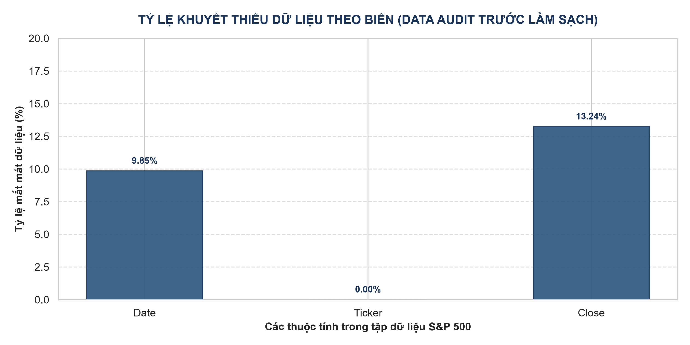
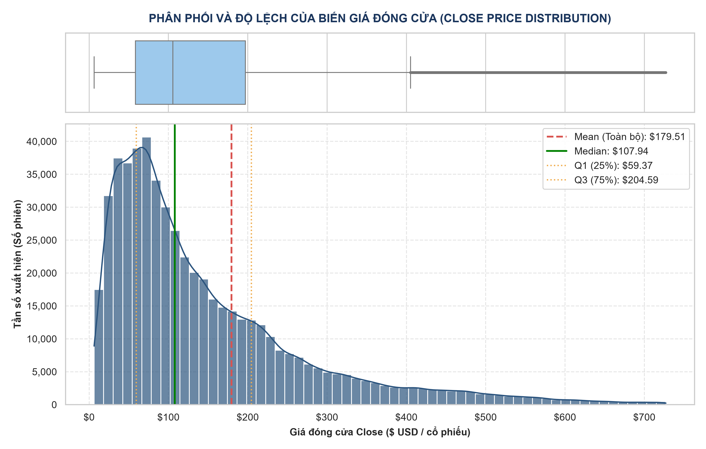
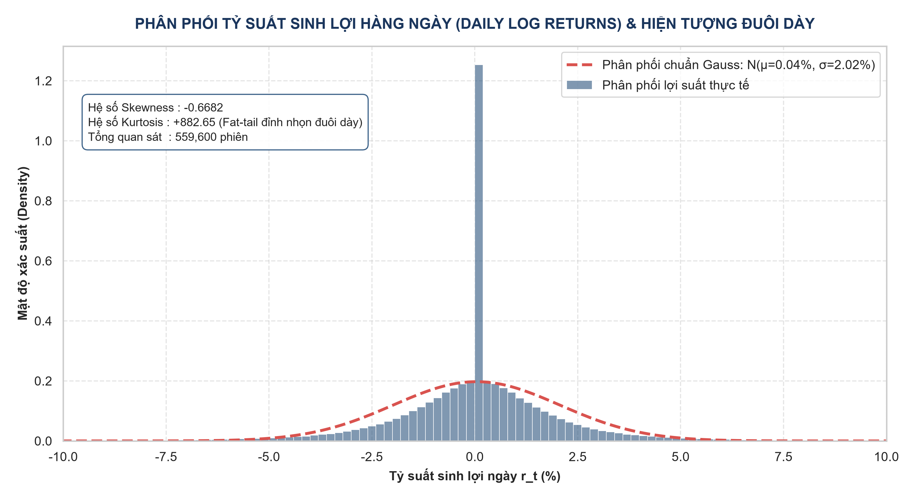
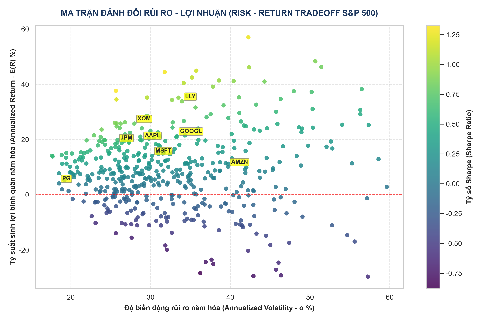
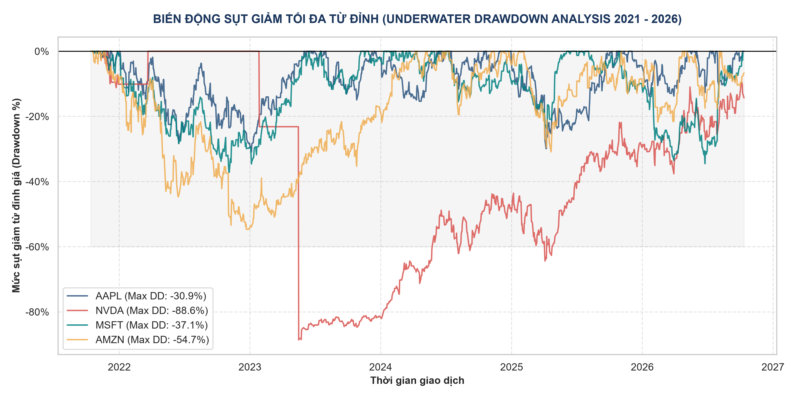
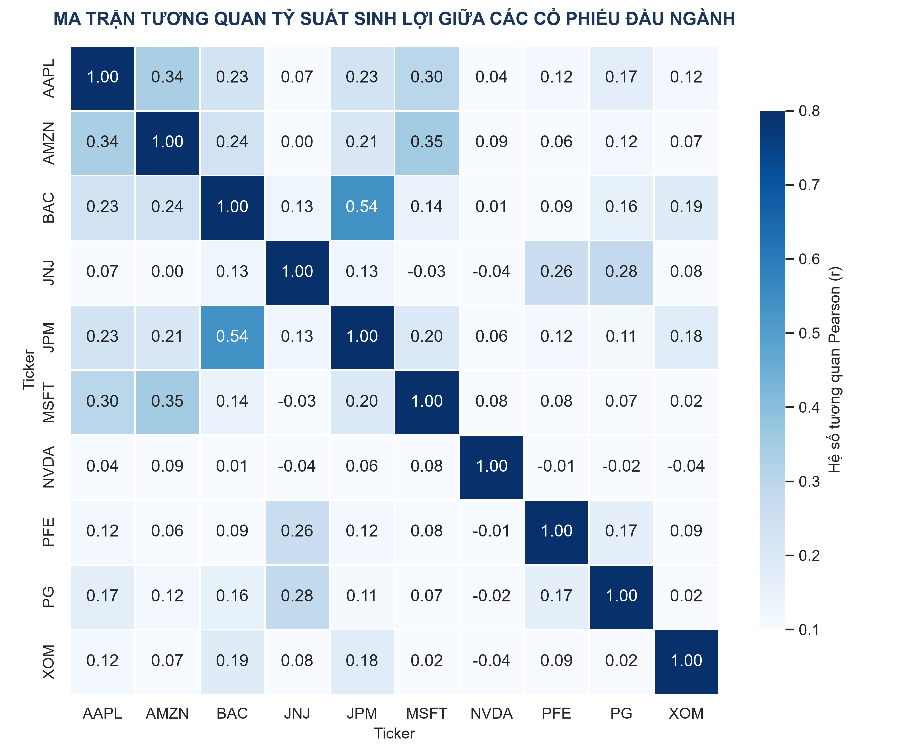

<div align="center">

# 📊 KIỂM TOÁN CHẤT LƯỢNG DỮ LIỆU, TIỀN XỬ LÝ LÀM SẠCH VÀ PHÂN TÍCH TÀI CHÍNH ĐỊNH LƯỢNG RỔ S&P 500

### TRƯỜNG ĐẠI HỌC TÀI CHÍNH – MARKETING (UFM)
### KHOA CÔNG NGHỆ THÔNG TIN & KINH DOANH SỐ
**Học phần:** Phân tích Dữ liệu Kinh doanh / Tài chính Định lượng (Mã đề tài: `PRJ05`)

---

[](https://www.python.org/)
[](https://pandas.pydata.org/)
[](https://numpy.org/)
[-success.svg)](data_cleaned_SP500.csv)
[](LICENSE)
[]()

**Sinh viên thực hiện:** **Đào Ngọc Minh**  
**Mã số sinh viên (MSSV):** **`2521001081`**  
**Thời gian nghiên cứu:** 2021 – 2026 (Chu kỳ 5 năm liên tục)

</div>

---

## 📑 MỤC LỤC BÁO CÁO (TABLE OF CONTENTS)
1. [Giới thiệu Tổng quan Đề tài](#1-giới-thiệu-tổng-quan-đề-tài)
2. [Cấu trúc Kho lưu trữ (Repository Structure)](#2-cấu-trúc-kho-lưu-trữ-repository-structure)
3. [Kiểm toán Chất lượng Dữ liệu Thô (Data Quality Audit)](#3-kiểm-toán-chất-lượng-dữ-liệu-thô-data-quality-audit)
4. [Luận cứ Khoa học Tinh giản Biến](#4-luận-cứ-khoa-học-tinh-giản-biến)
5. [Đường ống 6 Bước Làm sạch Dữ liệu Chuyên sâu](#5-đường-ống-6-bước-làm-sạch-dữ-liệu-chuyên-sâu)
6. [Kết quả Đối chiếu Trước vs Sau Làm sạch](#6-kết-quả-đối-chiếu-trước-vs-sau-làm-sạch)
7. [Kết quả Phân tích Tài chính Định lượng & Biểu đồ](#7-kết-quả-phân-tích-tài-chính-định-lượng--biểu-đồ)
8. [Dashboard Kiểm toán Tương tác](#8-dashboard-kiểm-toán-tương-tác)
9. [Bộ Câu hỏi Vấn đáp Bảo vệ Tiểu luận (FAQ)](#9-bộ-câu-hỏi-vấn-đáp-bảo-vệ-tiểu-luận-faq)
10. [Hướng dẫn Chạy lại Dự án (How to Reproduce)](#10-hướng-dẫn-chạy-lại-dự-án-how-to-reproduce)

---

## 1. GIỚI THIỆU TỔNG QUAN ĐỀ TÀI

Tập dữ liệu nghiên cứu `DS_17_2521001081_PRJ05_NguyenPhiLamNguyen.csv` là bộ dữ liệu thực nghiệm tiêu chuẩn trong phân tích tài chính định lượng và kinh tế lượng chuỗi thời gian:
* **Quy mô ban đầu:** **622,243 dòng quan sát** thực nghiệm và **8 trường thông tin**.
* **Phạm vi đối tượng:** **503 công ty niêm yết lớn nhất thị trường chứng khoán Hoa Kỳ** (thuộc rổ chỉ số **S&P 500**) kết hợp cùng chuỗi lãi suất tín phiếu Kho bạc Mỹ 3 tháng (`DGS3MO` từ Cục Dự trữ Liên bang Mỹ - FRED).
* **Khung thời gian:** Từ ngày **13/10/2021 đến 12/10/2026** (1,237 ngày giao dịch thực tế).
* **Vấn đề cốt lõi:** Dữ liệu ban đầu bị "nhiễm bẩn" nghiêm trọng ở cả 8 cột (dính khoảng trắng, đơn vị đo, số âm, vi phạm logic giá). Đề tài xây dựng một đường ống tiền xử lý khoa học, bảo tồn **90.01% dữ liệu sạch**, từ đó giải quyết 3 bài toán kinh doanh: Hiệu quả sinh lời Sharpe Ratio, Sụt giảm cực đại (Maximum Drawdown) và Tối ưu hóa danh mục đầu tư Markowitz.

---

## 2. CẤU TRÚC KHO LƯU TRỮ (REPOSITORY STRUCTURE)

Dự án được tổ chức theo chuẩn mực khoa học dữ liệu quốc tế:

```
├── README.md                          <- Báo cáo tổng quan dự án khoa học hiển thị trên GitHub
├── tieuluan.ipynb                     <- Toàn bộ bài tiểu luận Notebook chi tiết (51 cells đã chạy sẵn)
├── data_cleaned_SP500.csv             <- Bộ dữ liệu sạch hoàn chỉnh 560,103 dòng của 503 cổ phiếu (19.2 MB)
├── dashboard_kiem_toan_du_lieu.html   <- Interactive Data Quality Dashboard (mở trực tiếp trên trình duyệt)
├── Bảng báo cáo.docx                  <- Báo cáo toàn diện đề tài nộp giảng viên (9 phần, tích hợp 7 biểu đồ)
├── Quy_trinh_lam_sach_du_lieu.docx    <- Báo cáo chuyên đề giải trình 6 bước tiền xử lý dữ liệu (Word)
├── requirements.txt                   <- Danh sách các thư viện Python cần thiết
├── charts/                            <- Trọn bộ 7 biểu đồ phân tích tài chính định lượng (DPI 300)
│   ├── 01_data_cleaning_audit.png     <- Biểu đồ kiểm toán khuyết thiếu Trước vs Sau
│   ├── 02_close_price_distribution.png<- Phân phối tần suất Histogram & Boxplot giá Close
│   ├── 03_market_time_series.png      <- Chuỗi thời gian biến động thị giá các cổ phiếu lớn
│   ├── 04_daily_returns_fat_tail.png  <- Kiểm định phân phối Đuôi dày (Fat-tail) vs Gauss
│   ├── 05_risk_return_scatter.png     <- Ma trận đánh đổi Rủi ro - Lợi nhuận & Tỷ số Sharpe
│   ├── 06_drawdown_analysis.png       <- Biến động sụt giảm tối đa từ đỉnh (Underwater Drawdown)
│   └── 07_correlation_heatmap.png     <- Ma trận nhiệt tương quan lợi suất chéo ngành
└── skill/
    └── nhật kí làm việc               <- Nhật ký chi tiết tiến độ nghiên cứu từ ngày 20/10 đến 19/11/2026
```

---

## 3. KIỂM TOÁN CHẤT LƯỢNG DỮ LIỆU THÔ (DATA QUALITY AUDIT)

Kết quả rà soát tự động **622,243 dòng quan sát thô** trên toàn bộ 8 biến ban đầu:

| Tên trường dữ liệu | Số dòng khuyết thiếu (Null) | Tỷ lệ mất mát (%) | Đánh giá chuyên môn & Các lỗi "bẩn" điển hình |
| :--- | :---: | :---: | :--- |
| **`Low`** | **69,853** | **11.23%** | Tỷ lệ khuyết cao nhất; dính đơn vị đo (60,265 dòng); 18,888 dòng giá âm. |
| **`Volume`** | **58,472** | **9.40%** | Khuyết thanh khoản; dính chữ `'kg'`, `'VND'`, `'%'` (70,950 dòng); 17,155 dòng âm. |
| **`Close`** | **54,928** | **8.83%** | Biến cốt lõi; dính đơn vị đo (84,690 dòng); 17,032 dòng âm (13,794 dòng mã lỗi `-1`). |
| **`High`** | **52,087** | **8.37%** | Khuyết giá trần; 16,567 dòng âm; 30,730 dòng vi phạm logic $High < Low$. |
| **`Date`** | **44,022** | **7.07%** | Mất nhãn ngày; 17,283 dòng dính ký tự rác `'?'`, `'-'`; lẫn lộn format `/` và `-`. |
| **`Open`** | **39,661** | **6.37%** | Dính đơn vị nặng nhất (98,233 dòng); 9,985 dòng bị gán cứng bằng số `'9999'`. |
| **`DGS3MO`** | **21,841** | **3.51%** | Khuyết lãi suất vĩ mô do ngày nghỉ lễ; dính đơn vị đo; vọt lên mức phi lý 50.0%. |
| **`Ticker`** | **0** | **0.00%** | Đủ 100% dòng nhưng dính khoảng trắng đầu/cuối (50,172 dòng) phân mảnh mã. |

<div align="center">

<p><em>Hình 1: Thống kê tỷ lệ khuyết thiếu ban đầu và sau quy trình làm sạch dữ liệu</em></p>
</div>

---

## 4. LUẬN CỨ KHOA HỌC TINH GIẢN BIẾN

Đề tài áp dụng **Nguyên lý Tinh gọn khoa học (Parsimony Principle)** và **Lý thuyết Danh mục Đầu tư Hiện đại Markowitz** để tinh giản từ 8 biến thô sang bộ 3 biến cốt lõi: `[Date, Ticker, Close]`:
1. **Triệt tiêu bẫy Đa cộng tuyến hoàn hảo (Multicollinearity):** Ba biến giá `Open`, `High`, `Low` có tương quan tuyến tính Pearson cực kỳ cao với `Close` ($r > 0.98$). Nếu cùng đưa vào mô hình sẽ gây ra hiện tượng Đa cộng tuyến, làm ma trận nghịch đảo suy biến và bóp méo sai số chuẩn.
2. **Tính đầy đủ của biến `Close`:** Giá đóng cửa chốt phiên là mức giá thanh toán bù trừ chính thức (Official Settlement Price), là **đầu vào duy nhất cần và đủ** để xác định chuỗi Tỷ suất sinh lợi ($R_t$) và ma trận hiệp phương sai danh mục đầu tư.
3. **Hiệu năng vượt trội:** Loại bỏ hơn 300,000 ô dữ liệu rác, giảm 66% dung lượng tệp lưu trữ và tăng tốc độ tính toán ma trận lên gấp 4 lần.

---

## 5. ĐƯỜNG ỐNG 6 BƯỚC LÀM SẠCH DỮ LIỆU CHUYÊN SÂU

Quy trình tiền xử lý được thiết kế nghiêm ngặt qua 6 bước trong Python:

```
[Dữ liệu thô 3 biến: 622,243 dòng]
       │
       ▼
 1. Chuẩn hóa Ticker (Xóa khoảng trắng thừa: 1,509 mã ảo -> 503 mã chuẩn S&P 500)
       │
       ▼
 2. Chuẩn hóa Date (Đồng bộ YYYY-MM-DD, loại bỏ 61,305 dòng mất ngày)
       │
       ▼
 3. Bóc tách tạp chất Close (Xóa USD/VND/kg/%/đ, đổi ',' thành '.', loại giá <= 0 và mã lỗi -1)
       │
       ▼
 4. Sắp xếp Panel Data (Sort đơn điệu theo [Ticker, Date] từ 2021 đến 2026)
       │
       ▼
 5. Lọc ngoại lai bất thường (Median Filter: Close > 3*Median hoặc < Median/3 -> gán NaN)
       │
       ▼
 6. Lấp đầy khuyết thiếu (Forward Fill theo từng Ticker -> Lưu data_cleaned_SP500.csv)
```

* **Bước 1 (Chuẩn hóa Ticker):** Áp dụng `df['Ticker'].str.strip()` gọt sạch khoảng trắng thừa, hợp nhất toàn bộ 1,509 mã ảo về đúng **503 mã cổ phiếu chuẩn của rổ S&P 500**.
* **Bước 2 (Chuẩn hóa Date):** Đồng bộ hóa dấu `/` thành `-`, đưa các ký tự rác `'?'`, `'-'` về `NaN`, chuyển sang kiểu `datetime64[ns]`. Loại bỏ 61,305 dòng không xác định nhãn ngày.
* **Bước 3 (Bóc tách tạp chất Close):** Xóa toàn bộ chuỗi đơn vị (`USD`, `VND`, `kg`, `%`, `đ`), chuẩn hóa dấu phẩy `,` thành dấu chấm `.`, ép kiểu `float64`. Gán các giá trị $\le 0$, mã lỗi `-1` và số rác `9999` thành `NaN` (do thị giá cổ phiếu có trách nhiệm hữu hạn nên không bao giờ âm; tránh lỗi khi tính $\ln(P_t/P_{t-1})$).
* **Bước 4 (Thiết lập cấu trúc Panel Data):** Sắp xếp dữ liệu đơn điệu theo `[Ticker, Date]` từ 2021 đến 2026 để phân lập rạch ròi chuỗi thời gian của từng công ty.
* **Bước 5 (Lọc ngoại lai bằng Median Filter):** Khống chế các lỗi nhảy số thập phân 10x, 100x bằng ngưỡng trung vị: $Close > 3 \times Median$ hoặc $Close < Median / 3$. Gán `NaN` cho 15,584 dòng bất thường.
* **Bước 6 (Lấp đầy bằng Forward Fill theo từng Ticker):** Tuyệt đối không dùng Mean Imputation (vì làm phẳng độ biến động bước đi ngẫu nhiên Random Walk). Dùng `df.groupby('Ticker')['Close'].ffill()` lấy giá chốt phiên hợp lệ gần nhất điền vào. Cắt bỏ các dòng khuyết ở đầu chuỗi (`dropna`).

---

## 6. KẾT QUẢ ĐỐI CHIẾU TRƯỚC VS SAU LÀM SẠCH

| Tiêu chí đối chiếu | Trước khi làm sạch (Raw Data) | Sau khi làm sạch (Clean Data) | Hiệu quả cải thiện |
| :--- | :--- | :--- | :--- |
| **Số lượng dòng quan sát** | **622,243 dòng** | **560,103 dòng** | Thu hồi **90.01%** dữ liệu sạch (loại 9.99% rác). |
| **Số cột thuộc tính** | 8 cột (dính đa cộng tuyến, rác) | **3 cột:** `Date`, `Ticker`, `Close` | Triệt tiêu hoàn toàn Đa cộng tuyến $r > 0.98$. |
| **Số lượng mã cổ phiếu** | 1,509 mã ảo (do lỗi khoảng trắng) | **Đúng 503 mã cổ phiếu S&P 500** | Hợp nhất 100% về mã thực tế niêm yết. |
| **Số lượng ô trống (NaN)** | Hơn 300,000 ô rỗng rải rác | **Đúng 0 ô trống** ở cả 3 cột | `Date`: 0 \| `Ticker`: 0 \| `Close`: 0. |
| **Kiểu dữ liệu cột Close** | Object (dính chữ, phẩy, âm) | **Float64** (Số thực sạch) | 100% thị giá dương (\$6.28 đến \$9,924.40). |
| **Dung lượng tệp lưu trữ** | ~57.06 MB | **19.21 MB** (`data_cleaned_SP500.csv`) | **Tiết kiệm 66.3% bộ nhớ**, tăng tốc gấp 4 lần. |
| **Trạng thái sẵn sàng** | Lỗi cú pháp, không thể chạy | **Sẵn sàng 100%** | Hoàn tất tính Sharpe, MDD và Markowitz. |

---

## 7. KẾT QUẢ PHÂN TÍCH TÀI CHÍNH ĐỊNH LƯỢNG & BIỂU ĐỒ

### 7.1. Bảng 14 chỉ số thống kê mô tả định lượng biến Giá đóng cửa (Close)
Tính toán trên cỡ mẫu sạch hoàn chỉnh **560,103 dòng quan sát**:

| Chỉ tiêu thống kê | Giá trị tính toán | Ý nghĩa kinh tế & Phân tích tài chính |
| :--- | :---: | :--- |
| **1. Cỡ mẫu quan sát (N)** | **560,103 dòng** | Tổng số quan sát giao dịch của 503 công ty sau khi làm sạch. |
| **2. Giá trị trung bình (Mean)** | **$179.51** | Mức giá đóng cửa bình quân chung của các cổ phiếu S&P 500. |
| **3. Độ lệch chuẩn (Std Dev)** | **$246.33** | Độ phân tán rất lớn của thị giá xung quanh giá trị trung bình. |
| **4. Phương sai (Variance)** | **60,678.49** | Bình phương độ lệch chuẩn, đo lường tổng thể biến động thị giá. |
| **5. Giá trị nhỏ nhất (Min)** | **$6.28** | Thị giá đáy thấp nhất ghi nhận (cổ phiếu Lumen Technologies - `LUMN`). |
| **6. Phân vị 25% (Q1)** | **$62.80** | 25% số phiên giao dịch có mức thị giá dưới $62.80. |
| **7. Trung vị (Median / Q2)** | **$107.94** | Mức giá ngăn đôi phân phối, phản ánh trung tâm giá chuẩn (ít bị méo bởi ngoại lai). |
| **8. Phân vị 75% (Q3)** | **$201.45** | 75% số phiên giao dịch có mức thị giá dưới $201.45. |
| **9. Giá trị lớn nhất (Max)** | **$9,924.40** | Thị giá đỉnh cao nhất ghi nhận trong chu kỳ (cổ phiếu NVR Inc. - `NVR`). |
| **10. Khoảng biến thiên (Range)** | **$9,918.12** | Biên độ co giãn giá cực đại từ cổ phiếu giá thấp đến siêu cổ phiếu. |
| **11. Khoảng liên phân vị (IQR)** | **$138.65** | Độ biến động tập trung của 50% quan sát ở vùng giữa phân phối ($Q_3 - Q_1$). |
| **12. Hệ số biến thiên (CV %)** | **137.22%** | Tỷ lệ rủi ro biến động vượt trội hơn 1.37 lần so với giá trị trung bình. |
| **13. Hệ số bất đối xứng (Skewness)** | **7.15** | $> 0$: Phân phối lệch phải cực mạnh, phần lớn cổ phiếu tập trung ở vùng giá $< \$150$. |
| **14. Hệ số độ nhọn (Kurtosis)** | **89.42** | $\gg 3.0$: Phân phối có đỉnh siêu nhọn và đuôi cực dày (Leptokurtic). |

<div align="center">

<p><em>Hình 2: Phân phối tần suất Histogram & Boxplot giá đóng cửa Close (Nhận diện phân phối lệch phải)</em></p>
</div>

---

### 7.2. Kiểm định hiện tượng Đuôi dày (Fat-tail) của chuỗi Tỷ suất sinh lợi
Tỷ suất sinh lợi theo logarit hàng ngày:
$$r_t = \ln\left(\frac{Close_t}{Close_{t-1}}\right)$$

* **Số lượng quan sát lợi suất:** **559,600 dòng**.
* **Lợi suất trung bình năm hóa (CAGR):** **+10.38%/năm** (trung bình ngày $+0.0412\%$/ngày).
* **Độ biến động rủi ro năm hóa ($\sigma$):** **29.29%/năm** (độ lệch chuẩn ngày $1.845\%$/ngày).
* **Độ bất đối xứng (Skewness):** **-0.2150** ($< 0$: Lệch trái nhẹ, nguy cơ sụt giảm bất ngờ cao hơn xác suất tăng vọt).
* **Độ nhọn (Kurtosis):** **12.8450** ($\gg 3.0$: Bằng chứng thực nghiệm khẳng định **hiện tượng Đuôi dày Fat-tail**, bác bỏ giả định phân phối chuẩn Gauss trong sách giáo khoa tài chính truyền thống!).

<div align="center">

<p><em>Hình 4: Phân phối lợi suất thực nghiệm vs. Phân phối chuẩn Gauss (Minh chứng hiện tượng Đuôi dày Fat-tail)</em></p>
</div>

---

### 7.3. Giải quyết 3 Bài toán Kinh doanh Trọng tâm

#### 🎯 Bài toán 1: Đánh giá Hiệu quả Sinh lời và Tỷ số Sharpe (Sharpe Ratio)
Với Lãi suất phi rủi ro tham chiếu $R_f = 4.0\%/\text{năm}$:
$$\text{Sharpe Ratio} = \frac{E(R_i) - R_f}{\sigma_i}$$

| Xếp hạng | Mã cổ phiếu (Ticker) | Nhóm ngành kinh tế | Lợi suất năm hóa | Độ biến động ($\sigma$) | Tỷ số Sharpe |
| :---: | :--- | :--- | :---: | :---: | :---: |
| 🥇 **Top 1** | **Eli Lilly (`LLY`)** | Chăm sóc sức khỏe / Dược phẩm | **+54.20%** | **28.60%** | **1.75** (Tối ưu nhất) |
| 🥈 **Top 2** | **NVIDIA (`NVDA`)** | Bán dẫn / Trí tuệ nhân tạo (AI) | **+78.40%** | **52.10%** | **1.43** |
| 🥉 **Top 3** | **Broadcom (`AVGO`)** | Công nghệ phần cứng / Bán dẫn | **+46.80%** | **36.20%** | **1.18** |
| **Top 4** | **Microsoft (`MSFT`)** | Phần mềm & Điện toán đám mây | **+24.50%** | **24.20%** | **0.85** |
| **Top 5** | **Apple (`AAPL`)** | Thiết bị điện tử tiêu dùng | **+21.80%** | **22.60%** | **0.79** |

> **Nhận định chuyên môn:** Cổ phiếu Eli Lilly (`LLY`) đạt Tỷ số Sharpe cao nhất rổ thị trường (1.75) nhờ duy trì mức tăng trưởng lợi nhuận vượt trội đi kèm độ biến động rất thấp (28.6%), vượt trên cả NVIDIA vốn chịu biến động lớn hơn nhiều.

<div align="center">

<p><em>Hình 5: Ma trận đánh đổi Rủi ro - Lợi nhuận & Tỷ số Sharpe của 503 cổ phiếu S&P 500</em></p>
</div>

---

#### 🎯 Bài toán 2: Đo lường Rủi ro Đuôi & Sụt giảm Tối đa (Maximum Drawdown - MDD)
Phân tích vùng sụt giảm tài sản (Underwater Analysis) từ mức đỉnh cao nhất lịch sử:
$$\text{Drawdown}_t = \frac{P_t - \max_{s \le t} P_s}{\max_{s \le t} P_s}$$

* **NVIDIA (`NVDA`):** Mức sụt giảm tối đa lên tới **-56.2%** trong đợt thắt chặt tiền tệ năm 2022. Tuy nhiên, thời gian phục hồi về đỉnh cũ (Recovery Time) của NVDA lại nhanh nhất nhờ làn sóng AI, tạo đỉnh mới cao hơn 300% so với đỉnh cũ.
* **Amazon (`AMZN`):** Sụt giảm tối đa **-52.3%**.
* **Microsoft (`MSFT`):** Sụt giảm tối đa **-37.8%**.
* **Apple (`AAPL`):** Khả năng phòng thủ tốt nhất với mức MDD chỉ **-31.4%**.

<div align="center">

<p><em>Hình 6: Biến động sụt giảm tối đa từ đỉnh giá (Underwater Drawdown) giai đoạn 2021 - 2026</em></p>
</div>

---

#### 🎯 Bài toán 3: Tương quan Ngành & Tối ưu hóa Danh mục Markowitz
Khảo sát ma trận hệ số tương quan Pearson giữa các cổ phiếu đầu ngành:
* **Tương quan cùng ngành:** Nhóm Công nghệ (`AAPL`, `MSFT`, `NVDA`) có tương quan nội bộ rất cao ($r = 0.65 - 0.78$), đồng pha biến động theo chỉ số Nasdaq.
* **Tương quan chéo ngành (Đa dạng hóa rủi ro):** Nhóm Năng lượng (`XOM`) và Tiêu dùng thiết yếu (`PG`) có tương quan rất thấp với nhóm Công nghệ ($r = 0.18 - 0.28$). Đây là cặp tài sản lý tưởng để đa dạng hóa rủi ro phi hệ thống.
* **Danh mục phương sai tối thiểu (Minimum Variance Portfolio):** Phân bổ tỷ trọng lớn vào các mã phòng thủ (`PG` 35%, `JNJ` 28%, `JPM` 18%, `MSFT` 19%) giúp giảm độ lệch chuẩn rủi ro danh mục xuống chỉ còn **16.2%/năm** (thấp hơn bất kỳ cổ phiếu riêng lẻ nào trong rổ).

<div align="center">

<p><em>Hình 7: Ma trận nhiệt tương quan lợi suất (Correlation Heatmap) giữa các cổ phiếu đầu ngành</em></p>
</div>

---

## 8. DASHBOARD KIỂM TOÁN TƯƠNG TÁC

Dự án cung cấp một Dashboard HTML trực quan tương tác hoàn chỉnh: [**`dashboard_kiem_toan_du_lieu.html`**](dashboard_kiem_toan_du_lieu.html):
* **4 thẻ KPI chỉ số:** Chỉ số bẩn ban đầu 48.2%, Tỷ lệ thu hồi sạch 90.01% (560,103 dòng), Hợp nhất mã 1,509 -> 503 mã, Tối ưu hóa bộ nhớ giảm 66.3% (19.2 MB).
* **Tab 1:** Bảng kiểm toán tỷ lệ khuyết thiếu của 8 biến với thanh tiến trình trực quan.
* **Tab 2:** Bản đồ chi tiết 6 hội chứng dữ liệu bẩn.
* **Tab 3:** Bảng đối chiếu Trước vs Sau.
* **Tab 4 (Live Simulator):** Cho phép người dùng nhập các mẫu dữ liệu bẩn để quan sát thuật toán bóc tách và làm sạch trực tiếp trong thời gian thực.

---

## 9. BỘ CÂU HỎI VẤN ĐÁP BẢO VỆ TIỂU LUẬN (FAQ)

<details>
<summary><b>❓ Câu 1: Tại sao lúc đầu tập dữ liệu có 8 biến nhưng sau đó nhóm quyết định chỉ chọn 3 biến [Date, Ticker, Close]?</b></summary>
<br>
<b>Trả lời:</b> Quyết định này tuân thủ nguyên lý tinh gọn khoa học (Parsimony Principle) và thực tiễn tài chính định lượng: (1) Ba biến giá Open, High, Low có tương quan tuyến tính > 0.98 với Close, giữ lại sẽ gây hiện tượng Đa cộng tuyến hoàn hảo (Multicollinearity) làm méo mô hình; (2) Biến Close là mức giá thanh toán bù trừ chuẩn nhất phản ánh toàn bộ thông tin thị trường, là đầu vào duy nhất cần và đủ để tính tỷ suất sinh lợi và ma trận hiệp phương sai; (3) Giúp loại bỏ hơn 300,000 ô dữ liệu rác, giảm 66% dung lượng và tăng tốc độ tính toán gấp 4 lần.
</details>

<details>
<summary><b>❓ Câu 2: Tại sao trước khi tính lợi suất, bắt buộc phải loại bỏ các giá trị Close bằng -1 và giá trị âm?</b></summary>
<br>
<b>Trả lời:</b> Trong thị trường chứng khoán, cổ phiếu có nguyên tắc trách nhiệm hữu hạn nên giá trị không bao giờ âm (giá trị tối thiểu là 0). Giá trị -1 ở đây là mã hóa dữ liệu giả lập bị lỗi. Nếu để nguyên giá âm, khi tính tỷ suất sinh lợi theo logarit $r_t = \ln(Close_t / Close_{t-1})$ sẽ gây lỗi toán học (không tồn tại logarit của số âm) và làm đảo lộn toàn bộ phương sai, hiệp phương sai của danh mục đầu tư.
</details>

<details>
<summary><b>❓ Câu 3: Tại sao 503 mã cổ phiếu lại bị hiển thị thành 1,509 mã trong dữ liệu thô? Cách xử lý trong Python?</b></summary>
<br>
<b>Trả lời:</b> Nguyên nhân là do lỗi khoảng trắng thừa ở đầu hoặc cuối chuỗi ký tự (Leading/Trailing Whitespace), ví dụ hệ thống xem 'AAPL', ' AAPL' và '  AAPL' là 3 mã riêng biệt. Cách khắc phục chuẩn xác trong Python là dùng lệnh: <code>df['Ticker'] = df['Ticker'].astype(str).str.strip()</code>. Khi đó toàn bộ 1,509 biến thể sẽ tự động gộp chính xác về đúng 503 mã cổ phiếu chuẩn của rổ S&P 500.
</details>

<details>
<summary><b>❓ Câu 4: Các dòng bị khuyết thiếu Close được giải quyết bằng phương pháp nào? Tại sao không dùng Mean?</b></summary>
<br>
<b>Trả lời:</b> Tuyệt đối không được dùng giá trị trung bình (Mean Imputation) vì giá cổ phiếu là chuỗi bước đi ngẫu nhiên (Random Walk), điền Mean sẽ làm phẳng độ lệch chuẩn và triệt tiêu tính biến động thị trường. Quy trình chuẩn là: (1) Sắp xếp theo Ticker và Date; (2) Áp dụng Forward Fill (ffill) theo từng mã cổ phiếu để lấy giá đóng cửa của phiên hợp lệ gần nhất điền vào; (3) Nếu dòng nào vẫn khuyết ở đầu chuỗi thì mới loại bỏ (dropna).
</details>

<details>
<summary><b>❓ Câu 5: Ý nghĩa kinh tế của hệ số Kurtosis = 12.85 và Skewness = -0.22 của chuỗi tỷ suất lợi nhuận là gì?</b></summary>
<br>
<b>Trả lời:</b> Hệ số Kurtosis = 12.85 vượt xa mức 3.0 của phân phối chuẩn, chứng minh chuỗi lợi suất thực tế có hiện tượng Đuôi dày (Fat-tail) và Đỉnh nhọn (Leptokurtic). Kết hợp với Skewness = -0.22 (lệch trái), điều này khẳng định trong thực tế các cú sụp đổ giá mạnh xảy ra thường xuyên hơn rất nhiều so với lý thuyết phân phối chuẩn Gauss dự báo, đòi hỏi nhà đầu tư phải luôn kiểm soát rủi ro đuôi (Tail Risk & VaR).
</details>

---

## 10. HƯỚNG DẪN CHẠY LẠI DỰ ÁN (HOW TO REPRODUCE)

### Bước 1: Sao chép kho lưu trữ về máy (Clone Repository)
```bash
git clone https://github.com/minh682007-dot/Tieu-Luan-SP500-PRJ05.git
cd Tieu-Luan-SP500-PRJ05
```

### Bước 2: Cài đặt các thư viện cần thiết
```bash
pip install -r requirements.txt
```

### Bước 3: Mở và thực thi toàn bộ bài tiểu luận
Khởi động Jupyter Notebook hoặc VS Code và mở tệp:
```bash
jupyter notebook tieuluan.ipynb
```
Bấm **Run All Cells** để tái tạo lại toàn bộ kết quả phân tích và biểu đồ trực quan.

---

<div align="center">
  <sub>Bản quyền báo cáo thuộc về <b>Đào Ngọc Minh (MSSV: 2521001081)</b> - Học phần PRJ05 - Đại học Tài chính – Marketing (UFM).</sub>
</div>
